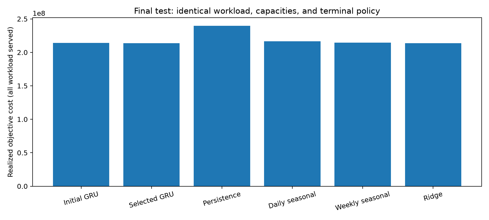

# greenload-forecast

GRU forecasting for workload, electricity price, water intensity, and carbon intensity,
followed by capacity-constrained MPC placement across ten data centers.

The experiment runner compares GRU setups with persistence, daily and weekly seasonal
persistence, a ridge forecaster, and a perfect-foresight scheduling oracle. The primary
selection metric is valid MPC cost; forecasting accuracy is reported separately.

## Reproduce the experiment

Python 3.11+ is required. From this directory:

```bash
python3 -m venv --system-site-packages .venv
source .venv/bin/activate
pip install -e ".[dev]"
make test
make lint
make smoke
python -m greenload.experiments --budget-hours 4 --run-dir results/experiments/reproduction
```

The quickstart uses a new output directory for an independent run. The published
`tuning-180d` directory already contains a completed search; using that directory
reuses its cached results. Repeat a command with the same arguments to resume it.
The default output directory, when `--run-dir` is omitted, is
`results/experiments/tuning-180d/`. It includes `report.md`, `leaderboard.csv`,
`search_state.json`, and a frozen `selection.json`. Use a new `--run-dir` for a new
search or changed source/configuration. Completed runs are cached; source changes cause
resumption to fail rather than mix incompatible results.

## Evaluation protocol

- One fixed 180-day hourly synthetic trace: 120 training days, 30 validation days,
  and 30 untouched final test days. Data seed and model seed are independent.
- Daily/weekly seasonal signals and correlated noise use independent RNG streams;
  increasing trace length preserves existing locations and signal prefixes.
- Targets belong entirely to their train/validation/test periods. Histories may use
  observations before the period boundary. Normalization fits training hours only.
- All candidates use the same training origins, with a shared 168-hour warmup.
  Histories of 24, 48, and 168 hours are compared; future calendar values are known
  features, while future observed signals are never inference inputs.
- Early stopping uses deployment inference without teacher forcing. Checkpoints save
  the best validation forecast loss, model configuration, scaler, and dataset checksum.
- The MPC horizon is 24 future hours plus the observed current hour. It shrinks at
  the known endpoint. Every evaluated method must finish the same workload.
- The synthetic workload is bounded by 95% of fleet hourly capacity. Both MPC and
  oracle constrain backlog after each action to at most
  `min(24, remaining hours) * (fleet capacity - workload upper bound)`.
  This common reserve rule guarantees future feasibility and terminal completion
  without consulting future actual arrivals. It is a benchmark policy, not a
  per-job delay-deadline model.
- Forecasts are scored in raw units before clipping. Scheduler inputs are bounded
  to physically admissible values, and clipping counts are logged.
- Forecast evaluation scores every available within-period target and masks targets
  beyond the endpoint. Scheduling covers every hour of each 30-day evaluation period.

## Search and stopping

The starting GRU uses 48 hours of history, 64 hidden units, one layer, no dropout,
direct 24-step decoding, AdamW at 0.001, batch size 64 time windows, gradient clipping
at 1, at most 60 epochs, and patience 8. Four separate signal models share the setup.

Coordinate search changes history, hidden size, layer/dropout pair, learning rate,
normalization, and finally direct versus scheduled-sampling autoregressive decoding.
Candidates are selected by validation MPC cost, with mean signal NRMSE breaking
numerical ties. A relative cost reduction of 0.5% is a meaningful improvement.

Stop after three full rounds without meaningful improvement, exhaustion of untried
neighbors, or the search-time limit. The first three hours are available for search;
the final hour is reserved for seeds 42/43/44, final evaluation, and reporting.
A budget stop is reported separately from a plateau. Failed or unfinished candidates
cannot replace the incumbent.

The selected configuration is frozen before the test month is evaluated. Seed repeats
measure initialization sensitivity on this fixed dataset; they do not measure
uncertainty across datasets. Simple baselines can outperform GRU, and the report
retains those outcomes.

## Train or evaluate one setup

```bash
python -m greenload.train --config settings.json --run-dir results/manual
python -m greenload.evaluate --run-dir results/manual --split val
python -m greenload.evaluate --run-dir results/manual --method ridge --split val
```

A settings file is the JSON representation of `greenload.config.Config`; omitted fields
use defaults. Save a template with:

```bash
python -c 'import json; from greenload.config import DEFAULT; print(json.dumps(DEFAULT.to_dict(), indent=2))' > settings.json
```

Evaluation loads the saved run settings, checkpoint scalers, and checksum-verified data.
Manual final-test evaluation requires `--split test --allow-test`; the experiment runner
uses its frozen selection automatically. Defaults for standalone training/evaluation
write to `results/manual/`.

Every run saves configuration, data identity and split boundaries, provenance, per-epoch
losses, best epochs and stopping reasons, raw forecasts, allocations, accuracy by signal,
location and horizon, geographic ranking errors, workload conservation, solver statuses,
and failure/timeout details. Checkpoint and array files stay local; configuration,
metrics, logs, reports, and figures can be committed.

## Results and historical reference

Start with the [results index](results/README.md) for current metrics, plots, logs,
and the separation between corrected and historical results.

The current experiment report is
[results/experiments/tuning-180d/report.md](results/experiments/tuning-180d/report.md).
Its figures and tables are generated from measured artifacts.

Original results and legacy entrypoint/configuration snapshots are preserved in
[results/historical/pre_tuning/](results/historical/pre_tuning/). They use the previous
457-hour protocol, overlapping train/validation targets, teacher-forced validation,
and different terminal workload handling, so their costs cannot be compared directly
with the corrected experiment. Root-level legacy result files are retained as well.

The demo notebook reads the frozen experiment artifacts without running another
test-driven search. This project uses synthetic data only; results do not establish
performance on real workload or environmental traces.

For window alignment, the capacity-reserve derivation, and artifact definitions, see
[docs/experiment_protocol.md](docs/experiment_protocol.md). The experiment directory also
contains an executable source snapshot and a training-only data profile.

<!-- BEGIN MEASURED RESULTS -->
## Measured experiment results

The completed search took 79.3 minutes: eight distinct GRU setups, four additional seed-confirmation runs, and 26 evaluations. It stopped after exhausting the evaluated coordinate neighbors, before the four-hour limit.

Final synthetic test month, model seed 42; lower is better:

| Method | MPC objective cost | Oracle gap | Mean NRMSE |
|---|---:|---:|---:|
| Persistence | 239,725,058.86 | 13.697% | 0.7733 |
| Daily seasonal | 216,474,084.04 | 2.669% | 0.3166 |
| Weekly seasonal | 214,582,577.37 | 1.772% | 0.2703 |
| Initial GRU (48h) | 214,102,570.63 | 1.544% | 0.1965 |
| Selected GRU (24h) | 213,817,370.51 | 1.409% | 0.2021 |
| Ridge | 213,724,872.68 | 1.365% | 0.1817 |

The selected GRU costs **10.81% less than persistence** and reduces mean NRMSE by **73.87%**. Every method serves the same workload completely.

Its single-seed cost gain over the corrected initial GRU is only 0.133%. Across seeds 42/43/44, the selected setup's mean cost is 0.0069% higher than the initial setup, so **a robust extra gain from hyperparameter tuning was not demonstrated**. Ridge has the lowest observed test cost; the selected GRU cost is 0.043% higher.

The default 48-hour configuration remains the corrected starting setup. The frozen validation-selected 24-hour setup is available in [configs/selected.json](configs/selected.json):

```bash
python -m greenload.train --config configs/selected.json --run-dir results/selected
python -m greenload.evaluate --run-dir results/selected --split val
```

See the [full report](results/experiments/tuning-180d/report.md), [interpretation](results/experiments/tuning-180d/analysis.md), and [artifact audit](results/experiments/tuning-180d/artifact_audit.json). These results establish performance on this fixed synthetic benchmark; the legacy 457-hour results use a different protocol.


<!-- END MEASURED RESULTS -->
